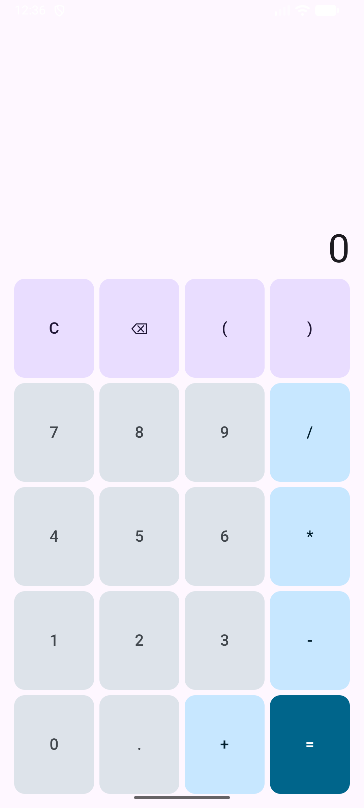
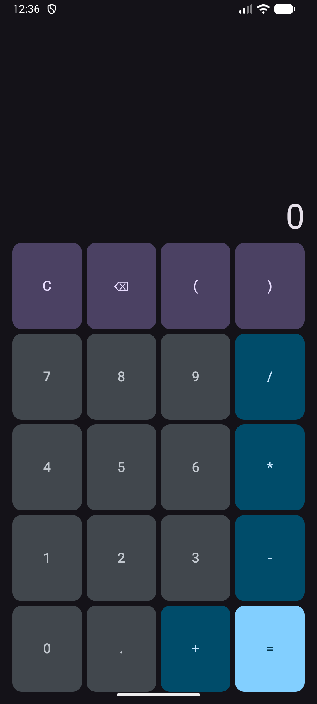
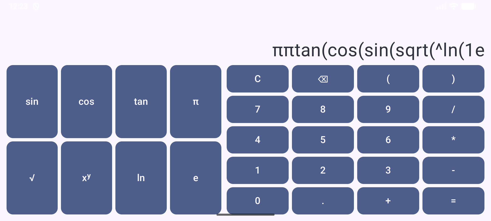

# Programowanie Systemów Mobilnych – Laboratorium 4
## Kalkulator (Część 1) – Responsywny interfejs użytkownika i Material 3

## Informacje ogólne
* **Autor:** Karol Budzyń
* **Uczelnia:** Akademia Tarnowska
* **Kierunek:** Informatyka, Inżynieria Systemów Inteligentnych
* **Technologia:** Jetpack Compose, Material 3, Kotlin

---

## Opis projektu
Celem pierwszej części projektu kalkulatora było zbudowanie w pełni responsywnego interfejsu działającego bezbłędnie w orientacji pionowej i poziomej oraz opracowanie autorskiej palety barw Material 3. Aplikacja nie posiada sztucznych blokad orientacji w manifeście, skaluje się do dostępnej przestrzeni ekranu za pomocą wag (`Modifier.weight`) i nie duplikuje kodu siatki przycisków pomiędzy widokami.

---

## Realizacja zadań

### Zadanie 1: Konfiguracja projektu i brak blokady orientacji
* Projekt założony na czystym szablonie Empty Activity.
* Zweryfikowano brak atrybutu `android:screenOrientation` w pliku `AndroidManifest.xml` – aplikacja płynnie reaguje na obrót urządzenia.

### Zadanie 2: Układ pionowy i elastyczna siatka
* Układ bazowy 4x5 zawierający cyfry, cztery działania arytmetyczne, nawiasy, kropkę dziesiętną, czyszczenie (`C`) oraz kasowanie ostatniego znaku (`⌫`).
* Przyciski zostały zamodelowane strukturą danych (`CalcButton`, `ButtonRole`), dzięki czemu interfejs iteruje po liście, eliminując powielanie kodu komponentów `Button`.
* Przestrzeń ekranu dzielona jest proporcjonalnie wagami (`Modifier.weight(1f)`), co gwarantuje prawidłowe skalowanie na ekranach o dowolnej przekątnej i gęstości pikseli.
* Pole działania obsługuje długie wyrażenia za pomocą poziomego przewijania (`Modifier.horizontalScroll`), eliminując problem ucinania tekstu.

### Zadanie 3: Układ poziomy i tryb naukowy
* Wykrywanie bieżącego trybu realizowane dynamicznie przez `LocalConfiguration.current.orientation`.
* W trybie poziomym obok bloku podstawowego odsłaniany jest blok funkcji naukowych (`sin`, `cos`, `tan`, `π`, `√`, `xʸ`, `ln`, `e`).
* **Zasada pojedynczej odpowiedzialności i brak duplikacji:** Obie siatki renderowane są przez dokładnie ten sam komponent `ButtonGrid`, wywoływany z odrębnymi zestawami danych.
* Przyciski funkcji wprowadzają automatycznie nawias otwierający (np. `sin(`), przygotowując strukturę pod analizator składniowy w części 2.

### Zadanie 4: Autorska paleta barw Material 3
* Wdrożono dedykowaną, autorską paletę barw wygenerowaną w oparciu o barwę bazową (`#00658B`).
* Wyłączono kolor dynamiczny systemu (`dynamicColor = false`), zapewniając powtarzalność i spójność wizualną na każdym urządzeniu.
* Przypisano semantyczne role kolorystyczne rozróżniające hierarchię elementów:
    * Przycisk `=` -> `primary` / `onPrimary`
    * Operatory arytmetyczne -> `primaryContainer` / `onPrimaryContainer`
    * Przyciski funkcyjne i akcje -> `tertiaryContainer` / `onTertiaryContainer`
    * Funkcje naukowe -> `secondaryContainer` / `onSecondaryContainer`
    * Cyfry -> `surfaceVariant` / `onSurfaceVariant`
* Wszystkie pary kolorów spełniają kryteria kontrastu tekstu do tła WCAG 2.2 na poziomie co najmniej 4.5:1.

---

## Odpowiedzi na pytania z konspektu

### 1. Zapis stałej $\pi$ w polu działania (Zadanie 3)
> **Pytanie:** Dlaczego przycisk $\pi$ powinien wpisywać nazwę stałej, a nie liczbę 3,14159?
>
> **Odpowiedź:** Wpisanie nazwy stałej zachowuje jej symboliczną tożsamość aż do momentu ewaluacji wyrażenia przez silnik obliczeniowy. Pozwala to na podstawienie wartości z maksymalną precyzją zmiennoprzecinkową udostępnianą przez środowisko wykonawcze (np. `Math.PI` o precyzji `Double` lub `BigDecimal`). Wpisanie sztywnego zaokrąglenia (np. `3.14159`) trwale obcina dokładność obliczeń już na etapie wprowadzania danych, co przy operacjach wyższego rzędu (np. funkcje trygonometryczne, potęgowanie) prowadzi do kumulacji błędów numerycznych.

### 2. Uzasadnienie wyboru koloru bazowego (Zadanie 4)
> **Pytanie:** Dlaczego wybrany został ten kolor bazowy?
>
> **Odpowiedź:** Jako kolor bazowy wybrano odcień morskiego błękitu (`#00658B`), ponieważ nawiązuje do estetyki precyzyjnych przyrządów pomiarowych i oprogramowania technicznego, a wyprowadzone z niego tonacje Material 3 zapewniają naturalny kontrast oraz doskonałą czytelność zarówno w trybie jasnym, jak i ciemnym.

---

## Zrzuty ekranu

| Tryb jasny (Pion) | Tryb ciemny (Pion) |
|:---:|:---:|
|  |  |

| Tryb poziomy (Naukowy) |
|:---:|
|  |